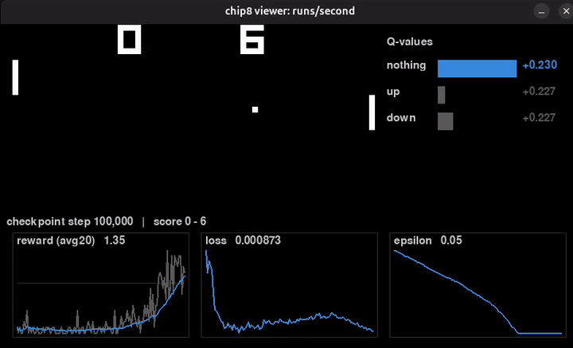

# A CHIP-8 emulator in Rust, and DQN agents written from scratch in PyTorch.

[](https://github.com/LasseRogers/chip8/actions/workflows/ci.yml)



| Path | Contents |
|---|---|
| `crates/chip8-core` | Emulator; COSMAC VIP and SUPER-CHIP profiles. Passes [Timendus' test suite](https://github.com/Timendus/chip8-test-suite). |
| `crates/chip8-desktop` | Play ROMs|
| `crates/chip8-py` | Python bindings (PyO3) |
| `rl/` | Gymnasium environments, DQN, training, live viewer |

## ROMs

Not included. Download into `roms/`:

```bash
mkdir -p roms && base="https://github.com/kripod/chip8-roms/raw/master/games"
curl -sSfL -o roms/pong.ch8     "$base/Pong%20%5BPaul%20Vervalin%2C%201990%5D.ch8"
curl -sSfL -o roms/pong1p.ch8   "$base/Pong%20%281%20player%29.ch8"
curl -sSfL -o roms/invaders.ch8 "$base/Space%20Invaders%20%5BDavid%20Winter%5D.ch8"
```

## Play

```bash
cargo run --release -p chip8-desktop -- roms/pong.ch8
cargo run --release -p chip8-desktop -- roms/invaders.ch8 --profile superchip
```

Keypad `123C 456D 789E A0BF` maps to `1234 QWER ASDF ZXCV`.

## Train

```bash
cd rl
uv run python scripts/train.py --game pong --run-dir runs/pong
uv run python scripts/view.py runs/pong   # live, alongside training
```

| Game | Random | Trained (500k steps, ~6 min on GPU) |
|---|---|---|
| `pong` | -8 | +4.5 |
| `invaders` | +3 | +19 |

## Checks

```bash
cargo fmt --check && cargo clippy --workspace --all-targets -- -D warnings && cargo test
cd rl && uv run ruff format --check . && uv run ruff check . && uv run pytest
```
